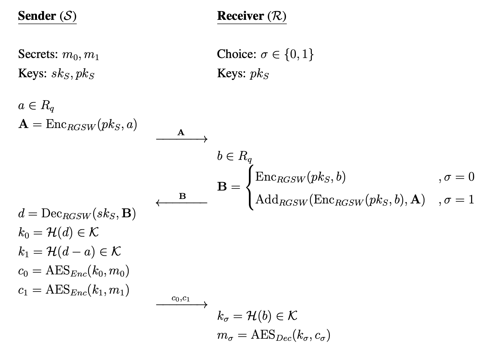
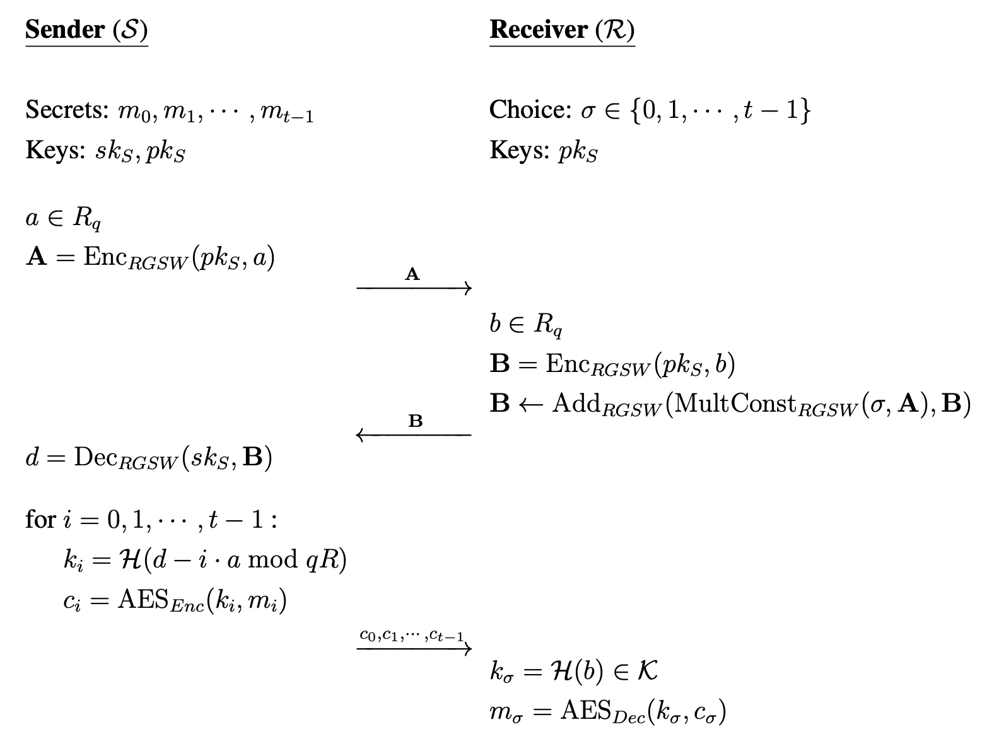

## RingGSW based Universally Composable Oblivious Transfer

Oblivious transfer (OT) is a cryptographic protocol that enables two parties to ex-
change information without revealing any information to each other. Many existing OT
protocols base their security on classical hard problems such as prime factorization and
the discrete logarithm problem. However, these problems can be solved by an ideal
quantum computer but there exists no known classical or quantum algorithm which can
break the LWE and Ring-LWE hard problems. Craig Gentry proposed a post-
quantum secure assymetric homomorphic encryption scheme (GSW scheme) based on
the LWE hard problem. We use the GSW scheme to construct its ring variant (RGSW)
based on the RLWE hard problem. We further use the RGSW scheme along with the
generic construction proposed in to construct these post-quantum secure protocols:

### 1 out of 2 OT

### 1 out of N transfer

